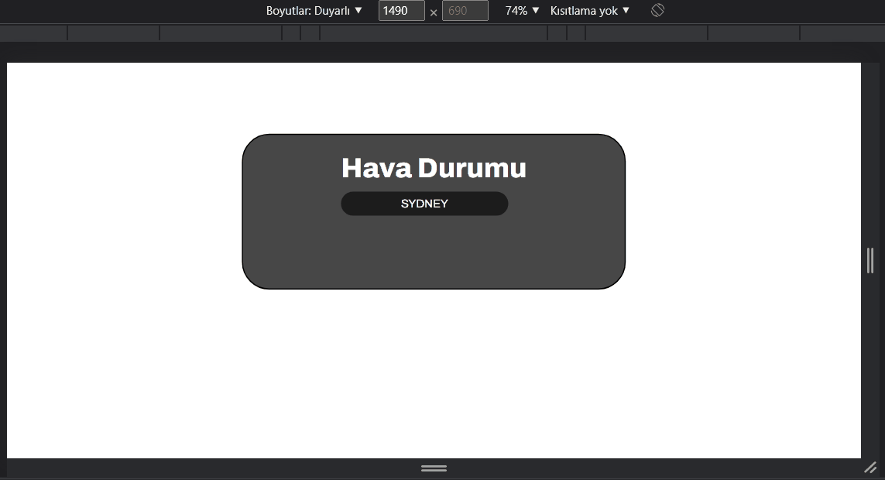

# Weather App

A small frontend project for exploring a weather application interface.

## Demo

[Open the live demo](https://mealigezik.github.io/weather-app/)

## Preview

## Scope

This repository contains a browser-based learning project. Live weather-data access may be unavailable or disabled depending on the API configuration; consult the source code before expecting current forecast data.

## Run

Open the project through GitHub Pages or serve the files locally from a local HTTP server if required by the browser modules.

## Status

Educational project, not a production weather service.
